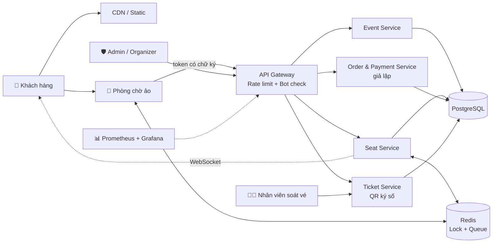

<div align="center">

# 🎫 Concert Ticketing System

### Hệ thống bán vé concert chống "phe vé" và chịu tải cao


*Tài liệu đặc tả chức năng (Functional Specification)*

</div>

---

## 📑 Mục lục tài liệu

| #  | Tài liệu | Mô tả |
|----|----------|-------|
| 01 | [Tổng quan dự án](docs/01-tong-quan.md) | Bối cảnh, vấn đề, mục tiêu, phạm vi, ràng buộc |
| 02 | [Vai trò & phân quyền](docs/02-vai-tro-phan-quyen.md) | Các tác nhân và ma trận phân quyền |
| 03 | [Đặc tả chức năng](docs/03-chuc-nang/README.md) | Danh mục chức năng chi tiết theo vai trò |
| 03.1 | ↳ [Quản trị viên (ADMIN)](docs/03-chuc-nang/01-admin.md) | Tài khoản, danh mục, cấu hình chống bot, giám sát, báo cáo |
| 03.2 | ↳ [Ban tổ chức (ORGANIZER)](docs/03-chuc-nang/02-organizer.md) | Sự kiện, ghế, đơn hàng, nhân viên soát vé, báo cáo |
| 03.3 | ↳ [Nhân viên soát vé (CHECK-IN STAFF)](docs/03-chuc-nang/03-checkin-staff.md) | Quét QR, soát vé ngoại tuyến |
| 03.4 | ↳ [Khách hàng (CUSTOMER)](docs/03-chuc-nang/04-customer.md) | Phòng chờ ảo, chọn ghế, thanh toán, vé QR |
| 03.5 | ↳ [Hệ thống (SYSTEM)](docs/03-chuc-nang/05-system.md) | Hàng đợi, khóa phân tán, chống bot, giám sát |
| 04 | [Kiểm thử & chỉ số đo](docs/04-kiem-thu-chi-so.md) | Load test, security test, KPI |
| 05 | [Thuật ngữ](docs/05-thuat-ngu.md) | Giải thích thuật ngữ kỹ thuật |

---

## 🚀 Giới thiệu nhanh

Mỗi lần mở bán vé concert lớn, website thường **sập vì quá tải**, đồng thời **bot gom vé** để bán lại với giá cao. Dự án xây dựng một nền tảng bán vé giải quyết đồng thời hai vấn đề:

| Vấn đề | Giải pháp cốt lõi |
|--------|-------------------|
| 🔥 Quá tải khi mở bán | Phòng chờ ảo (virtual waiting room), điều tiết lưu lượng, cache, mở rộng ngang |
| 🤖 Bot gom vé | Rate limiting, device fingerprint, phân tích hành vi, risk score, CAPTCHA, giới hạn theo danh tính |
| 🪑 Bán trùng ghế | Khóa phân tán (distributed lock) + ràng buộc duy nhất ở CSDL + idempotency |
| 🎟️ Vé giả | Vé QR có chữ ký số, QR động, mỗi vé chỉ check-in một lần |

---

## 🏗️ Kiến trúc tổng quan



> Sơ đồ ở mức khái niệm; công nghệ cụ thể sẽ chốt trong tài liệu thiết kế kiến trúc.

---

## 📂 Cấu trúc thư mục

```
concert-ticketing-system/
├── README.md                        # Trang chủ & mục lục
└── docs/
    ├── 01-tong-quan.md
    ├── 02-vai-tro-phan-quyen.md
    ├── 03-chuc-nang/
    │   ├── README.md                # Mục lục đặc tả chức năng
    │   ├── 01-admin.md
    │   ├── 02-organizer.md
    │   ├── 03-checkin-staff.md
    │   ├── 04-customer.md
    │   └── 05-system.md
    ├── 04-kiem-thu-chi-so.md
    └── 05-thuat-ngu.md
```

---

## 📐 Quy ước tài liệu

**Mã chức năng**

| Tiền tố | Vai trò |
|---------|---------|
| `ADM-xx` | Quản trị viên |
| `ORG-xx` | Ban tổ chức sự kiện |
| `STF-xx` | Nhân viên soát vé |
| `CUS-xx` | Khách hàng |
| `SYS-xx` | Hệ thống (xử lý nền) |
| `TST-xx` | Kịch bản kiểm thử |
| `BR-xx`  | Quy tắc nghiệp vụ (business rule) |

**Mức ưu tiên (MoSCoW)**

| Mức | Ý nghĩa |
|-----|---------|
| 🔴 **Must** | Bắt buộc có trong bản demo |
| 🟠 **Should** | Nên có, làm sau khi xong Must |
| 🟢 **Could** | Có thì tốt, làm nếu còn thời gian |

---

## 🕒 Lịch sử phiên bản

| Phiên bản | Ngày | Nội dung |
|-----------|------|----------|
| v0.1 | 2026-10-13 | Khởi tạo bộ tài liệu đặc tả chức năng |
