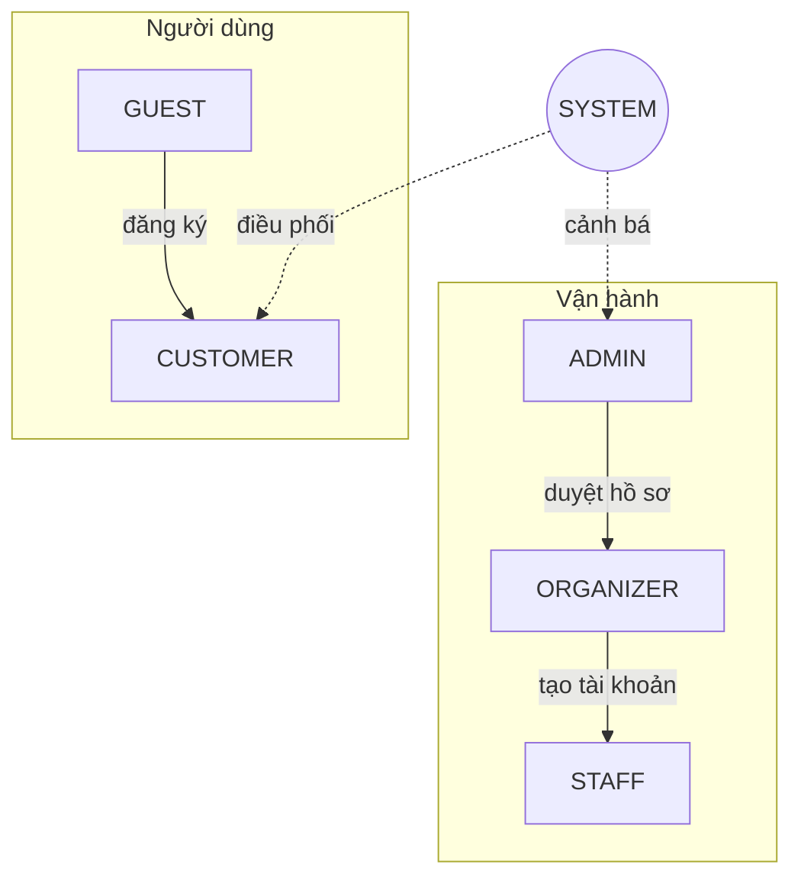

[🏠 Trang chủ](../README.md) › **02. Vai trò & phân quyền**

# 02. Vai trò & phân quyền

**Nội dung:** [Danh sách tác nhân](#1-danh-sách-tác-nhân) · [Sơ đồ tác nhân](#2-sơ-đồ-tác-nhân) · [Ma trận phân quyền](#3-ma-trận-phân-quyền) · [Quy tắc phân quyền](#4-quy-tắc-phân-quyền)

---

## 1. Danh sách tác nhân

| Mã | Tác nhân | Mô tả | Giao diện |
|----|----------|-------|-----------|
| `ADMIN` | Quản trị viên | Vận hành toàn bộ nền tảng, cấu hình chống bot, xử lý gian lận | Trang quản trị |
| `ORGANIZER` | Ban tổ chức sự kiện | Tạo sự kiện, thiết lập vé, quản lý đơn hàng của sự kiện mình | Trang quản trị (giới hạn) |
| `STAFF` | Nhân viên soát vé | Quét QR, xác thực vé tại cổng | Trang soát vé (mobile web) |
| `CUSTOMER` | Khách hàng | Mua vé, quản lý vé | Website khách hàng |
| `GUEST` | Khách vãng lai | Xem sự kiện, chưa đăng nhập | Website khách hàng |
| `SYSTEM` | Hệ thống | Tác nhân nền: hàng đợi, khóa ghế, chống bot, gửi thông báo | Không có |

## 2. Sơ đồ tác nhân

## 3. Ma trận phân quyền

> ✅ Được phép · 🔸 Chỉ trong phạm vi của mình · ❌ Không được phép

| Nhóm quyền | ADMIN | ORGANIZER | STAFF | CUSTOMER | GUEST |
|------------|:-----:|:---------:|:-----:|:--------:|:-----:|
| Xem danh sách sự kiện công khai | ✅ | ✅ | ✅ | ✅ | ✅ |
| Quản lý tài khoản người dùng | ✅ | ❌ | ❌ | ❌ | ❌ |
| Duyệt ban tổ chức / duyệt sự kiện | ✅ | ❌ | ❌ | ❌ | ❌ |
| Quản lý danh mục, địa điểm, sơ đồ ghế | ✅ | ❌ | ❌ | ❌ | ❌ |
| Cấu hình phòng chờ, rate limit, CAPTCHA | ✅ | ❌ | ❌ | ❌ | ❌ |
| Xử lý phiên nghi bot, blacklist | ✅ | ❌ | ❌ | ❌ | ❌ |
| Tạo / sửa / hủy sự kiện | ✅ | 🔸 | ❌ | ❌ | ❌ |
| Thiết lập hạng vé, giá, đợt mở bán | ✅ | 🔸 | ❌ | ❌ | ❌ |
| Khóa / mở ghế thủ công | ✅ | 🔸 | ❌ | ❌ | ❌ |
| Xem đơn hàng, xử lý hoàn vé | ✅ | 🔸 | ❌ | 🔸 | ❌ |
| Tạo tài khoản soát vé | ✅ | 🔸 | ❌ | ❌ | ❌ |
| Quét QR, check-in | ✅ | ❌ | 🔸 | ❌ | ❌ |
| Vào phòng chờ, chọn ghế, thanh toán | ❌ | ❌ | ❌ | ✅ | ❌ |
| Xem vé QR, chuyển nhượng vé | ❌ | ❌ | ❌ | 🔸 | ❌ |
| Xem báo cáo toàn hệ thống | ✅ | ❌ | ❌ | ❌ | ❌ |
| Xem báo cáo sự kiện | ✅ | 🔸 | 🔸 | ❌ | ❌ |
| Xem audit log | ✅ | ❌ | ❌ | ❌ | ❌ |

## 4. Quy tắc phân quyền

| Mã | Quy tắc |
|----|---------|
| `BR-01` | Phân quyền theo vai trò (RBAC); mọi API kiểm tra quyền ở phía server, không tin dữ liệu từ client. |
| `BR-02` | ORGANIZER chỉ thao tác trên sự kiện do chính mình tạo (kiểm tra quyền sở hữu, chống IDOR). |
| `BR-03` | STAFF chỉ soát vé của sự kiện và cổng được phân công, trong khung giờ sự kiện. |
| `BR-04` | Tài khoản vận hành (ADMIN, ORGANIZER) bắt buộc bật 2FA. |
| `BR-05` | Mọi thao tác thay đổi dữ liệu của ADMIN/ORGANIZER được ghi vào audit log, không thể xóa. |
| `BR-06` | Một người dùng chỉ có một vai trò chính; tài khoản vận hành không được dùng để mua vé. |

---

[← 01. Tổng quan](01-tong-quan.md) · [🏠 Mục lục](../README.md) · [03. Đặc tả chức năng →](03-chuc-nang/README.md)

