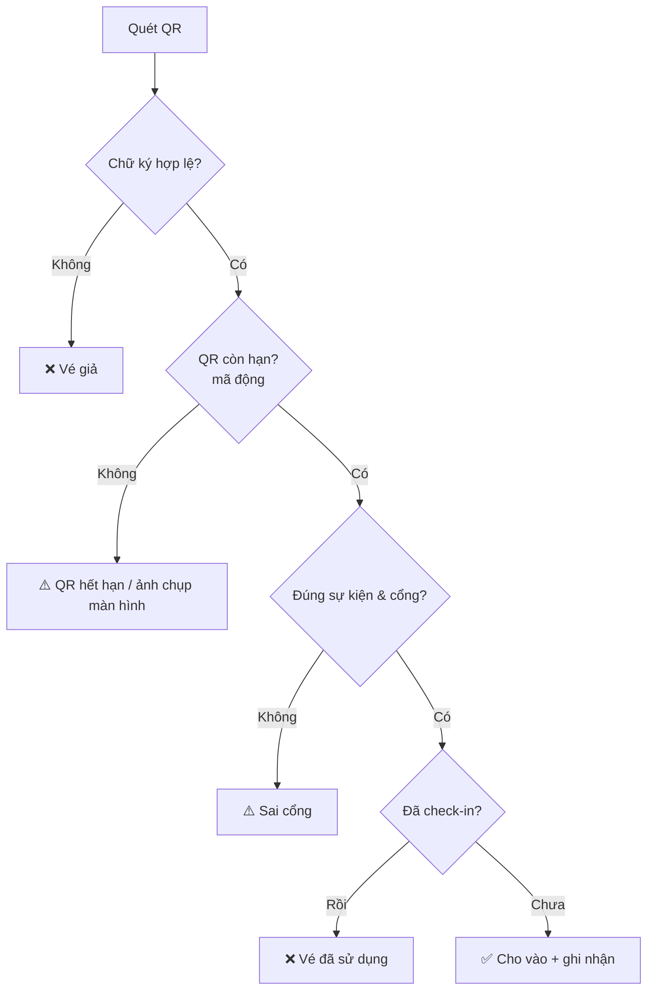

[🏠 Trang chủ](../../README.md) › [03. Đặc tả chức năng](README.md) › **3.3 Nhân viên soát vé (STAFF)**

# 3.3 Nhân viên soát vé (CHECK-IN STAFF)

> Nhân viên tại cổng vào sự kiện: quét mã QR, xác thực vé và ghi nhận check-in, kể cả khi mất kết nối mạng.

**Nội dung:** [A. Soát vé](#a-soát-vé) · [B. Hoạt động ngoại tuyến](#b-hoạt-động-ngoại-tuyến) · [C. Thống kê nhanh](#c-thống-kê-nhanh) · [Luồng soát vé](#luồng-soát-vé)

---

## A. Soát vé

| Mã | Chức năng | Mô tả | Ưu tiên |
|----|-----------|-------|:-------:|
| `STF-01` | Quét mã QR | Quét QR trên điện thoại khán giả bằng camera hoặc máy quét. | 🔴 Must |
| `STF-02` | Xác thực vé | Kiểm tra chữ ký số, đúng sự kiện, đúng cổng, còn hiệu lực. | 🔴 Must |
| `STF-03` | Đánh dấu đã sử dụng | Ghi nhận check-in; cảnh báo rõ ràng khi vé đã được quét trước đó (giờ, cổng). | 🔴 Must |
| `STF-04` | Tra cứu vé thủ công | Tìm vé theo mã đơn / mã vé khi không quét được QR. | 🟠 Should |

## B. Hoạt động ngoại tuyến

| Mã | Chức năng | Mô tả | Ưu tiên |
|----|-----------|-------|:-------:|
| `STF-05` | Tải trước dữ liệu vé | Tải danh sách vé hợp lệ và khóa công khai để xác thực khi mất mạng. | 🟠 Should |
| `STF-06` | Đồng bộ check-in | Gửi lại kết quả check-in ngoại tuyến khi có mạng, phát hiện xung đột giữa các cổng. | 🟠 Should |

## C. Thống kê nhanh

| Mã | Chức năng | Mô tả | Ưu tiên |
|----|-----------|-------|:-------:|
| `STF-07` | Đếm check-in | Số vé đã check-in / tổng số vé tại cổng phụ trách. | 🟢 Could |

---

## Luồng soát vé

## Quy tắc nghiệp vụ liên quan

| Mã | Quy tắc |
|----|---------|
| `BR-30` | Mỗi vé chỉ được check-in thành công một lần. |
| `BR-31` | Khi đồng bộ ngoại tuyến có hai lượt check-in cùng một vé, lượt sớm hơn được giữ, lượt sau bị gắn cờ để admin xem xét. |

---

[← 3.2 ORGANIZER](02-organizer.md) · [🏠 Mục lục](../../README.md) · [3.4 CUSTOMER →](04-customer.md)

