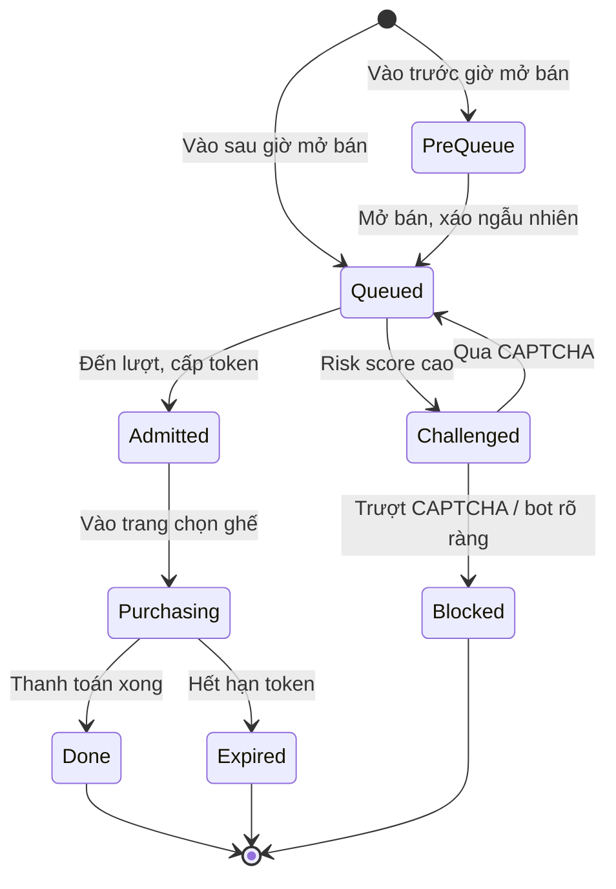

[🏠 Trang chủ](../../README.md) › [03. Đặc tả chức năng](README.md) › **3.5 Hệ thống (SYSTEM)**

# 3.5 Hệ thống (SYSTEM – xử lý nền)

> Các cơ chế chạy nền, không do người dùng trực tiếp thao tác, nhưng là cốt lõi của bài toán: điều tiết tải, chống bán trùng ghế, chống bot và bảo vệ vé.

**Nội dung:** [A. Phòng chờ & điều phối tải](#a-phòng-chờ-ảo--điều-phối-tải) · [B. Chống bán trùng ghế](#b-chống-bán-trùng-ghế) · [C. Phát hiện & chặn bot](#c-phát-hiện--chặn-bot) · [D. Bảo mật vé](#d-bảo-mật-vé) · [E. Giám sát & vận hành](#e-giám-sát--vận-hành)

---

## A. Phòng chờ ảo & điều phối tải

| Mã | Chức năng | Mô tả | Ưu tiên |
|----|-----------|-------|:-------:|
| `SYS-01` | Hàng đợi phân tán | Lưu hàng đợi trên Redis (Sorted Set), độc lập với các service mua vé. | 🔴 Must |
| `SYS-02` | Ngẫu nhiên hóa trước giờ mở bán | Người vào trước giờ mở bán được xáo vị trí ngẫu nhiên; người vào sau xếp theo thời điểm đến. | 🔴 Must |
| `SYS-03` | Cấp access token | Cấp JWT có chữ ký, gắn tài khoản + thiết bị + sự kiện, có thời hạn; API mua vé từ chối request không có token. | 🔴 Must |
| `SYS-04` | Điều tiết tốc độ cho vào | Cho vào theo tốc độ cấu hình; tự giảm khi độ trễ / tỉ lệ lỗi backend vượt ngưỡng. | 🟠 Should |

## B. Chống bán trùng ghế

| Mã | Chức năng | Mô tả | Ưu tiên |
|----|-----------|-------|:-------:|
| `SYS-05` | Khóa phân tán ghế | `SET seat:{showId}:{seatId} {orderId} NX PX <ttl>`; chỉ một request giữ được ghế. Thao tác nhiều ghế dùng Lua script để giữ tất cả hoặc không ghế nào. | 🔴 Must |
| `SYS-06` | Ràng buộc ở CSDL | Ràng buộc `UNIQUE(show_id, seat_id)` trên bảng vé hợp lệ, là lớp bảo vệ cuối khi lock gặp sự cố. | 🔴 Must |
| `SYS-07` | Tự giải phóng ghế | Ghế tự trả về khi hết TTL; chỉ chủ lock (đúng `orderId`) mới được nhả lock. | 🔴 Must |
| `SYS-08` | Đồng bộ trạng thái ghế | Phát sự kiện thay đổi trạng thái ghế qua WebSocket / Pub-Sub tới mọi client đang xem. | 🔴 Must |
| `SYS-09` | Idempotency thanh toán | Mỗi lần thanh toán có idempotency key; gọi lại không tạo đơn hoặc vé thứ hai. | 🔴 Must |

## C. Phát hiện & chặn bot

| Mã | Chức năng | Mô tả | Ưu tiên |
|----|-----------|-------|:-------:|
| `SYS-10` | Rate limiting | Token bucket theo IP, thiết bị, tài khoản tại API Gateway; trả `429` khi vượt ngưỡng. | 🔴 Must |
| `SYS-11` | Device fingerprinting | Thu thập dấu hiệu trình duyệt, phát hiện headless browser (WebDriver, thiếu API, header bất thường). | 🔴 Must |
| `SYS-12` | Phân tích hành vi | Tốc độ thao tác, chuyển động chuột, thời gian giữa các bước, mẫu request lặp lại. | 🟠 Should |
| `SYS-13` | Chấm điểm rủi ro | Tổng hợp tín hiệu thành risk score 0–100; quyết định cho qua / CAPTCHA / chặn. | 🔴 Must |
| `SYS-14` | Giới hạn theo danh tính | Đếm số vé theo tài khoản, SĐT, thẻ thanh toán; chặn khi vượt giới hạn. | 🔴 Must |

## D. Bảo mật vé

| Mã | Chức năng | Mô tả | Ưu tiên |
|----|-----------|-------|:-------:|
| `SYS-15` | QR có chữ ký số | Payload vé được ký bằng khóa riêng (Ed25519/ECDSA); thiết bị soát vé xác thực bằng khóa công khai. | 🔴 Must |
| `SYS-16` | QR động | Payload gồm mã TOTP đổi mỗi 30 giây; ảnh chụp màn hình cũ không còn hiệu lực. | 🟠 Should |
| `SYS-17` | Check-in một lần | Cập nhật trạng thái vé nguyên tử (atomic) khi check-in. | 🔴 Must |

## E. Giám sát & vận hành

| Mã | Chức năng | Mô tả | Ưu tiên |
|----|-----------|-------|:-------:|
| `SYS-18` | Metrics & dashboard | Prometheus thu thập metrics, Grafana hiển thị: RPS, độ trễ p95/p99, lỗi, độ dài hàng đợi. | 🔴 Must |
| `SYS-19` | Log tập trung & cảnh báo | Gom log các service, cảnh báo khi tỉ lệ lỗi hoặc độ trễ vượt ngưỡng. | 🟠 Should |
| `SYS-20` | Cache & mở rộng ngang | Cache sự kiện, sơ đồ ghế (Redis/CDN); các service không trạng thái chạy nhiều bản sau load balancer. | 🟠 Should |

---

## Tham khảo nghiên cứu

| Chủ đề | Nội dung cần tìm hiểu |
|--------|------------------------|
| Ticketmaster Smart Queue / Verified Fan | Cơ chế xếp hàng, xác minh fan trước khi mở bán |
| Queue-it | Phòng chờ ảo đặt trước hệ thống, xáo thứ tự trước giờ mở bán, token qua cửa |
| Distributed locking | Redis `SET NX PX`, Redlock và các tranh luận về độ an toàn, fencing token |
| Bot detection | Fingerprinting, phân tích hành vi, CAPTCHA, giới hạn theo danh tính |

---

[← 3.4 CUSTOMER](04-customer.md) · [🏠 Mục lục](../../README.md) · [04. Kiểm thử & chỉ số đo →](../04-kiem-thu-chi-so.md)

