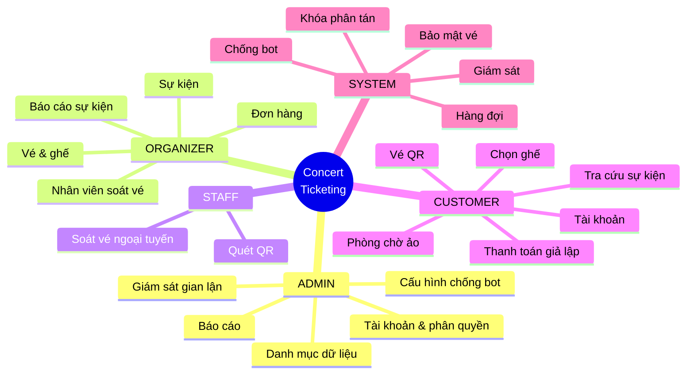
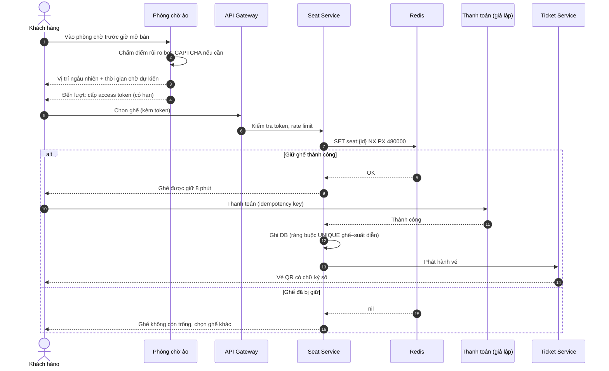

[🏠 Trang chủ](../../README.md) › **03. Đặc tả chức năng**

# 03. Đặc tả chức năng

Danh mục chức năng được chia theo vai trò. Mỗi chức năng có mã định danh, mô tả và mức ưu tiên MoSCoW (🔴 Must · 🟠 Should · 🟢 Could).

---

## 📑 Mục lục

| #   | Tài liệu | Nhóm chức năng | Số chức năng |
|-----|----------|----------------|:------------:|
| 3.1 | [Quản trị viên (ADMIN)](01-admin.md) | Tài khoản & phân quyền · Danh mục dữ liệu · Cấu hình chống phe vé & chịu tải · Giám sát gian lận · Thống kê & báo cáo | 21 |
| 3.2 | [Ban tổ chức (ORGANIZER)](02-organizer.md) | Sự kiện · Vé & ghế · Đơn hàng · Nhân viên soát vé · Báo cáo | 15 |
| 3.3 | [Nhân viên soát vé (STAFF)](03-checkin-staff.md) | Soát vé · Hoạt động ngoại tuyến · Thống kê nhanh | 7 |
| 3.4 | [Khách hàng (CUSTOMER)](04-customer.md) | Tài khoản · Tra cứu sự kiện · Phòng chờ ảo · Chọn ghế · Thanh toán · Quản lý vé · Thông báo | 30 |
| 3.5 | [Hệ thống (SYSTEM)](05-system.md) | Phòng chờ & điều phối tải · Chống bán trùng ghế · Chống bot · Bảo mật vé · Giám sát & vận hành | 20 |

---

## 🗺️ Bản đồ chức năng

---

## 🔄 Luồng nghiệp vụ chính: mua vé

---

[← 02. Vai trò & phân quyền](../02-vai-tro-phan-quyen.md) · [🏠 Mục lục](../../README.md) · [3.1 ADMIN →](01-admin.md)

